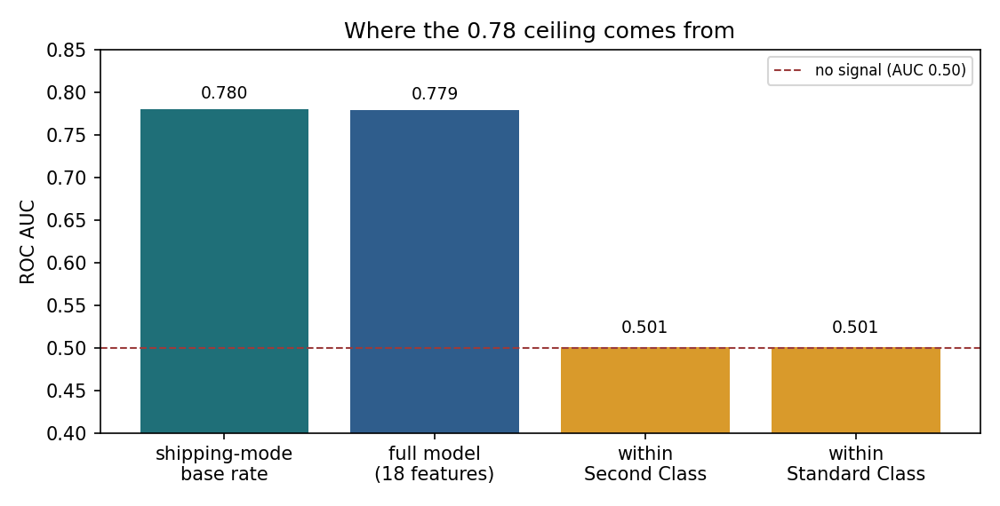
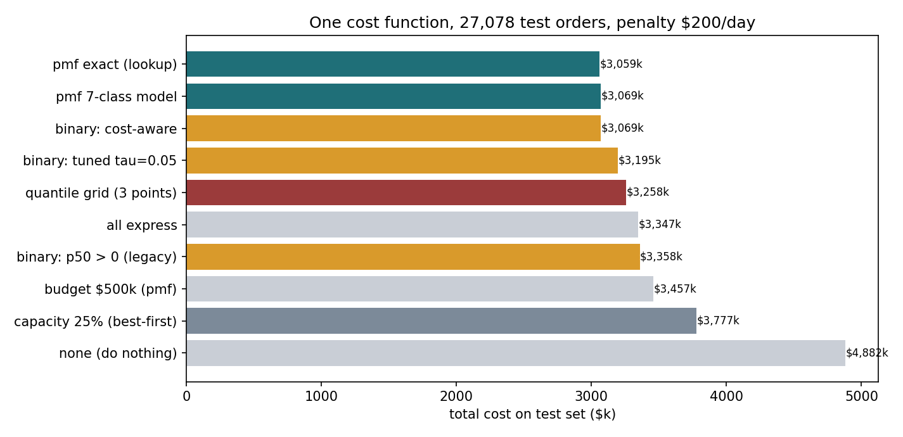
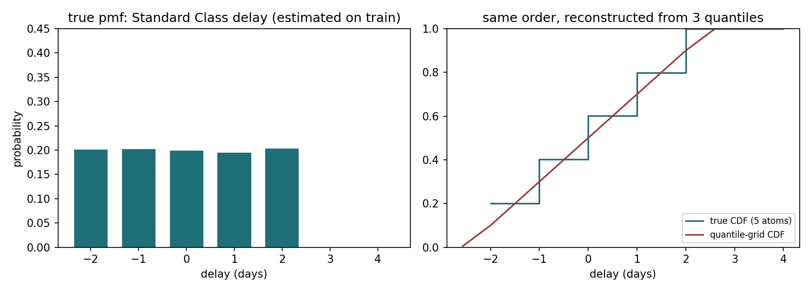
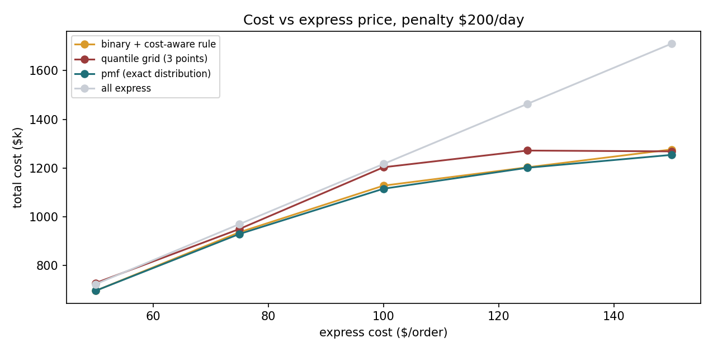
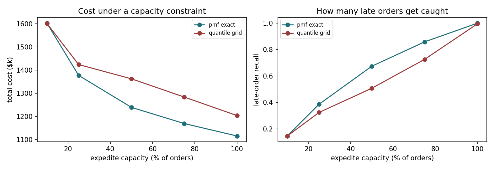
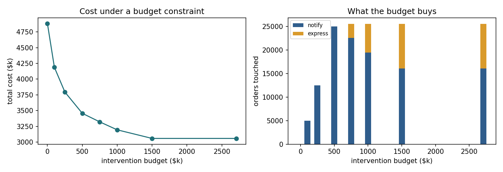
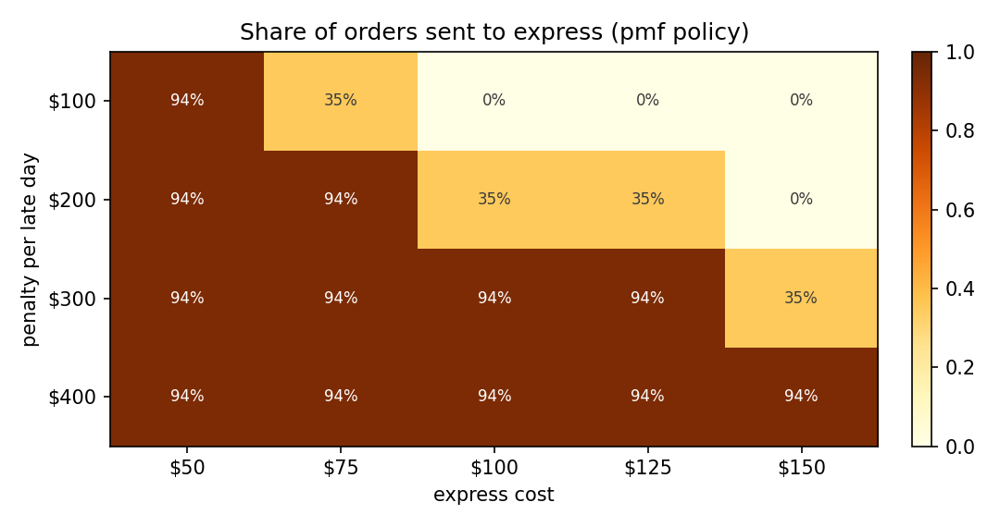

# 供应链延迟交付：把预测变成成本决策

[](https://github.com/lingtao-meng/supply-chain-ml-pipeline/actions/workflows/ci.yml)
[](https://opensource.org/licenses/MIT)
[](https://www.python.org/)

用 DataCo 全球供应链数据（180,519 条订单）回答一个业务问题：**哪些订单值得花钱干预？**

仓库分两层：

1. **预测层** — P10/P50/P90 分位数回归、迟到二分类、7 类离散分布模型
2. **决策层** — 统一成本函数、期望成本最小化、预算 / 产能约束

复现全部数字（约 3 分钟）：

```bash
make data        # 下载 91 MB 数据到 data/
make reproduce   # 训练 → 诊断 → 成本表 → results/ + 模型包
```

---

## 结论先行

| # | 结论 | 证据 |
|---|---|---|
| 1 | **0.78 的 AUC 是这份数据的信息天花板**，不是模型没调好 | 只用 `Shipping Mode` 查表 AUC **0.7803**；18 特征模型 **0.7794**；方式内部 AUC **≈0.50** |
| 2 | 延迟只有 7 个整数取值，**必须直接建模离散分布** | 3 分位插值 **$3.258M**；7 类 pmf **$3.069M**；精确 pmf **$3.059M** |
| 3 | 「分位数回归比二分类强」这个结论**站不住** | 二分类拿到同一个决策层后 **$3.069M**，与 pmf 只差 **0.35%** |
| 4 | **决策规则比模型类别重要** | 同一测试集上，11 个策略成本从 $2.12M（事后最优）到 $4.88M（不干预） |
| 5 | 收益主要来自**不给不该加急的订单加急** | 最优策略按运输方式 3 行规则；分位策略多干预 5.4 个百分点，多花 6.1% |
| 6 | **干预率是成本参数的函数**，不是模型属性 | 固定 $200/天 → 干预 94%；按订单金额 1%/天 → 干预 0%；罚金 $100/加急 $100 时加急 0% |

> **v1 → v2 修正了两个口径问题**：二分类基线用了 `p50 > 0` 这个稻草人阈值；用 3 个分位点拼分布来评估一个 7 原子目标。详见文末「从 v1 到 v2」。

---

## 业务问题

订单延迟交付的代价很高，但业务上真正要回答的不是「这单会不会晚」，而是：

1. 会晚几天？（点估计不够，需要分布）
2. 值不值得花钱干预？（加急成本 vs 延迟罚金）
3. 只能加急一部分时，先加急哪些？（产能约束下的排序）

把这三个问题放进同一个成本函数，才能比较「模型」「规则」和「什么都不做」。

---

## 数据

DataCo Supply Chain Dataset（Kaggle 公开数据）。180,519 条订单，54 个字段，2015-01-01 → 2018-01-31。

- 迟到率 **54.7%**，平均延迟 0.54 天，累计延迟 16.3 万天
- 目标：`delay_days = 实际运输天数 − 承诺运输天数`
- 延迟取值只有 **−2, −1, 0, 1, 2, 3, 4** 七个整数
- `Days for shipping (real)`、`Delivery Status`、`Late_delivery_risk` 都是事后字段，**全部排除**

---

## 方法

| 环节 | 做法 |
|---|---|
| 特征 | 18 维，仅下单时点可得：日期派生、金额/折扣、交互项、类别编码 |
| 切分 | 按订单日期 70/15/15，训练用过去、测试用未来（非随机切分） |
| 分布模型 | `GradientBoostingRegressor(loss="quantile")` × P10/P50/P90；`HistGradientBoostingClassifier` 7 类 pmf |
| 决策 | 对每个动作算 `E[cost] = 动作成本 + 罚金 × 系数 × E[(D − 减天数)+]`，取最小 |
| 评估 | 统一成本函数 + 配对 bootstrap 置信区间 + 产能曲线 |

**动作菜单**

| 动作 | 固定成本 | 效果 |
|---|---|---|
| 不干预 | $0 | — |
| 提前通知 | $20 | 罚金 × 0.6 |
| 加急 | $100 | 减 2 天 |

---

## 结果 1：0.78 是信息天花板



- 运输方式基线的 AUC 是 **0.7803**，18 特征模型是 **0.7794**，差 −0.0008
- 拆开看：`Second Class` 内部 AUC **0.5012**，`Standard Class` 内部 **0.5008**
- 卡方检验（Standard Class 内部，n=107,752）：Market p=0.106 / V=0.007，Category p=1.000 / V=0.017，Segment p=0.071 / V=0.008

原因很直接：这个数据集的运输天数在每个运输方式内部近似**均匀随机生成**——
Standard Class 的延迟在 −2..2 各占约 20%，Second Class 在 0..4 各占约 20%。
所以 0.78 不是建模失败，而是「运输方式解释了全部可得信息」。

> **这条诊断比多 0.01 AUC 更有用**：它说明继续做特征工程是在拟合噪声，
> 也解释了为什么 SHAP 里 `Shipping Mode` 的贡献是第二名的 50 倍。

---

## 结果 2：统一成本函数下的 11 个策略

测试集 27,078 单，罚金 $200/天，加急 $100/单：

| 策略 | 总成本 | 单均成本 | 干预率 | 通知 | 加急 | 迟到召回 | 命中率 |
|---|---|---|---|---|---|---|---|
| 事后最优（upper bound） | $2,120,100 | $78.30 | 54.7% | 1,054 | 13,757 | 100.0% | 100.0% |
| **pmf 精确（运输方式分布）** | **$3,058,600** | **$112.96** | 94.4% | 16,047 | 9,511 | 100.0% | 58.0% |
| pmf 7 类模型 | $3,068,900 | $113.34 | 94.4% | 14,313 | 11,244 | 100.0% | 57.9% |
| 二分类 + 成本决策层 | $3,069,200 | $113.35 | 94.4% | 15,151 | 10,407 | 100.0% | 58.0% |
| 二分类 + 验证集调阈值 | $3,194,800 | $117.99 | 94.4% | 0 | 25,558 | 100.0% | 58.0% |
| **分位网格（3 点插值）** | **$3,258,160** | **$120.32** | 99.8% | 21,415 | 5,613 | 99.9% | 54.7% |
| 全量加急 | $3,346,800 | $123.60 | 100% | 0 | 27,078 | 100.0% | 54.7% |
| 二分类 `p50 > 0`（旧基线） | $3,358,100 | $124.02 | 98.1% | 0 | 26,557 | 98.6% | 55.0% |
| 预算 $500k（pmf 增量贪心） | $3,457,000 | $127.67 | 92.3% | 25,000 | 0 | 98.5% | 58.3% |
| 产能 25%（按期望收益排序） | $3,776,800 | $139.48 | 25.0% | 0 | 6,770 | 38.5% | 84.2% |
| 不干预 | $4,882,200 | $180.30 | 0% | 0 | 0 | 0% | — |

几个关键比值：

- 不干预 → pmf：**−37.4%**
- 3 分位插值 → pmf：**−6.1%**（$199,560）
- 旧的 `p50>0` 基线 → pmf：**−8.9%**
- 公平二分类 → pmf：**−0.35%**（$10,600，统计显著但业务上可忽略）
- 事后最优 → pmf：还有 44% 的差距，这部分来自**单笔延迟的不可预测性**，不是决策规则能补的



### 配对 bootstrap（相对 pmf 精确策略，单均成本）

| 策略 | Δ$/单 | 95% CI |
|---|---|---|
| pmf 7 类模型 | +0.38 | [+0.10, +0.67] |
| 二分类 + 成本决策层 | +0.39 | [+0.18, +0.59] |
| 二分类调阈值 | +5.03 | [+4.15, +5.87] |
| 分位网格 | +7.37 | [+7.17, +7.58] |
| 全量加急 | +10.64 | [+9.75, +11.55] |
| 旧 `p50>0` 基线 | +11.06 | [+10.15, +11.95] |
| 预算 $500k | +14.71 | [+14.20, +15.19] |
| 不干预 | +67.35 | [+66.06, +68.59] |

3% 量级的差距在 2.7 万单上也可能显著，所以每个结论都带区间：
pmf 与公平二分类的差距虽然显著，但 **$0.39/单 ≈ 0.35%**，不足以支撑「分位数回归更好」的叙事。

---

## 结果 3：为什么 3 个分位点不够



左图是 Standard Class 的真实延迟分布（5 个原子，各约 20%）；右图是模型用 P10/P50/P90
重建出的 CDF。三点插值把一条**平坦的离散分布**拉成了连续直线，尾部被系统性高估：

- 决策规则里要算 `E[(D−2)+]`，真实分布下是 `(0+0+1+2)/5 = 0.6` 天
- 三点插值给出的尾部形状不同，导致 99.8% 的订单被干预（真实最优是 94.4%）

直接建模 7 类概率后，`E[(D−r)+] = Σ p_d · max(d−r, 0)` 是精确的，成本降到 $3.059M。
**这是本项目唯一一个「换模型能省钱」的地方，省 6.1%。**

---

## 结果 4：参数灵敏度——什么时候值得做模型

固定加急 $100 时，改变罚金；以及固定罚金 $200 时，改变加急成本。表里是 pmf 相对 3 分位插值的降本：

| 罚金 \ 加急 | $50 | $100 | $150 |
|---|---|---|---|
| $100/天 | +0.3% | +0.1% | +0.1% |
| $200/天 | +3.9% | +6.1% | +0.9% |
| $300/天 | +3.3% | +1.1% | +5.2% |
| $400/天 | +2.9% | +0.9% | +0.8% |



20 组参数里 pmf 一次都没有输给 3 分位插值（0.07%–8.2%）。
但 pmf 相对**公平二分类**的差距只有 −0.005% 到 +2.6%，其中 4 组参数下二分类反而最优——
这说明**模型类别的选择在这个数据集上无关紧要，分布表示和决策规则才重要**。

旧 README 里「加急 $100、罚金 $100/天时降本 34%」的数字，来自把二分类基线设成
「p50>0 就加急」；那个基线在 $100 加急成本下等于「几乎全量加急」，当然会输 34%。

---

## 结果 5：产能约束下，排序才真正值钱



| 可加急比例 | pmf 成本 | 分位成本 | pmf 召回 | 分位召回 |
|---|---|---|---|---|
| 10% | $4,390,000 | $4,390,800 | 14.7% | 14.7% |
| 25% | **$3,776,800** | $3,880,520 | **38.5%** | 32.9% |
| 50% | **$3,388,700** | $3,692,700 | **68.0%** | 51.0% |
| 75% | **$3,197,520** | $3,505,680 | **86.2%** | 69.1% |
| 100% | $3,058,600 | $3,258,160 | 100% | 99.9% |

产能越紧，排序质量越重要：25% 产能下 pmf 的召回比 3 分位高 5.6 个百分点，
到 50% 时高 17 个百分点——因为分位插值把太多订单排在「伪高风险」区间。

---

## 结果 6：预算约束——先花在哪



| 预算 | 总成本 | 通知 | 加急 | 召回 | 说明 |
|---|---|---|---|---|---|
| $0 | $4,882,200 | 0 | 0 | 0% | 不干预 |
| $100k | $4,187,080 | 5,000 | 0 | 27.1% | 只够通知 |
| $500k | $3,457,000 | 25,000 | 0 | 98.5% | 通知几乎覆盖全部 |
| $750k | $3,321,080 | 22,573 | 2,985 | 100% | 开始升级加急 |
| $1M | $3,194,960 | 19,448 | 6,110 | 100% | 加急 6,110 单（占干预 24%） |
| $1.5M | **$3,058,600** | 16,047 | 9,511 | 100% | 达到无约束最优 |

预算曲线用的是**增量贪心**：从「不干预」出发，每次选边际收益/边际成本最高的下一步，
并允许 `通知 → 加急` 的 $80 升级。朴素的「每单只选一个动作」版本会丢掉升级收益：
$1M 预算下它只花得出 $511k，成本停在 $3.44M，而增量贪心能花到 $1M、成本降到 $3.19M。

---

## 结果 7：决策是成本结构的阶跃函数



同一个模型、同一批订单，只改「罚金/加急」两个参数，加急比例就会从 0% 跳到 94%：

| 罚金 \ 加急 | $50 | $100 | $150 |
|---|---|---|---|
| $100/天 | 94% | 0% | 0% |
| $200/天 | 94% | 35% | 0% |
| $300/天 | 94% | 94% | 35% |
| $400/天 | 94% | 94% | 94% |

剩下 6% 是 Same Day 订单——它们本来就不会延迟，任何参数下都不该加急。
所以「干预率」不是模型属性，而是**成本参数的函数**；先对齐成本口径，再谈模型好坏。

### 成本模型假设（比模型选择更重要）

| 成本模型 | 中位罚金/天 | 干预率 | 加急率 |
|---|---|---|---|
| 固定 $200/天（本文基准） | $200 | 94.4% | 35.1% |
| 订单金额 1%/天，最低 $20 | $20 | 0% | 0% |

中位订单金额只有 **$180**：1%/天 = $1.8，最低 $20 仍远低于 $100 的加急成本，所以最优动作是全部不干预。
换句话说，**「应该干预 94% 订单」是 $200/天这个假设的产物**。真实部署的第一步是和业务校准罚金
与加急成本，而不是继续调模型。`src/policy.py` 已支持逐单罚金数组，`results/cost_model_check.csv` 可复现这张表。

---

## 复现

```bash
python -m venv .venv && source .venv/bin/activate
pip install -r requirements.txt

make data        # 或手动放 data/DataCoSupplyChainDataset.csv
make reproduce   # 全部数字：results/ + images/ + models/model_bundle.joblib
make test        # 46 个单测，不需要数据集
make smoke       # 合成数据端到端（CI 同款）
make app         # Streamlit 演示

# 批量评分：CSV → 预测 + 建议动作 + 期望成本
python scripts/score_orders.py --input orders.csv --out plan.csv --budget 500000
```

- 首次训练分位模型约 2 分钟，之后走缓存；缓存键包含数据指纹、超参、特征/成本模块源码指纹，改代码会自动失效
- 数据路径会自动查找：`--data` → `data/` → kagglehub 缓存
- `python scripts/refresh_cost_analysis.py --fast` 用微型模型跑通全链路（真实数据约 30 秒）
- 单笔决策演示：`streamlit run app/app.py`（加载真实模型包，无随机数）

---

## 项目结构

```
src/pipeline.py                    数据加载、18 维特征、时间切分、编码器
src/policy.py                      统一成本函数、11 个策略、pmf/预算决策、bootstrap
scripts/refresh_cost_analysis.py   一键复现：训练 → 天花板诊断 → 成本表 → 模型包
scripts/score_orders.py            批量评分：CSV → 预测 + 建议动作 + 期望成本
app/app.py                         Streamlit：输入订单 → 分布 → 期望成本 → 动作
tests/                             46 个单测 + 合成数据夹具（CI 用）
notebooks/                         探索过程（成本口径已统一到 src/policy.py）
results/                           summary.md、policy_comparison.csv、bootstrap.csv、budget_curve.csv…
images/                            7 张由脚本生成的图 + notebook 探索图
```

---

## 从 v1 到 v2（改了什么）

v2 是对 v1 的**修正与补强**，不是重写。旧的预测数字全部原样复现
（AUC 0.7794、分位策略 $3,258,160、旧二分类 $3,358,100、不干预 $4,882,200），
变化都在「比较方式」和「工程可信度」上：

| # | v1 的问题 | v2 的修法 |
|---|---|---|
| 1 | **Streamlit app 是假模型**：硬编码权重 + `np.random.normal` 噪声，却写着 XGBoost / AUC 0.744 | 删除假逻辑；脚本导出真实模型包，app 加载后输出真实分位、真实 pmf、真实期望成本 |
| 2 | **notebook 与 README 成本口径冲突**：notebook 显示 $628K / $509K / 省 $119K，README 是 $3.26M / $3.36M | notebook 第 5、6 节改为调用 `src/policy.py`，全量重跑，结论与 README 一致 |
| 3 | **二分类基线是稻草人**：`p50 > 0` 就加急 | 加入「二分类 + 同一期望成本决策层」和「验证集调阈值」两个公平基线 |
| 4 | **3 分位插值被当作分布** | 直接建模 7 类 pmf；用精确 `E[(D−r)+]` 决策，省 6.1% |
| 5 | 差异只有点估计，没有不确定性 | 配对 bootstrap 置信区间 |
| 6 | `requirements.txt` 锁死旧版本，Python 3.12 装不上 | 改为版本区间；新增 `requirements-dev.txt` / `requirements-notebook.txt` |
| 7 | CI 只跑 10 个单测 | ruff + 3.10/3.12 单测 + 合成数据端到端 + Streamlit 冒烟 |
| 8 | 缓存只看「文件在不在」，改特征会静默复用旧模型 | 缓存键包含数据指纹、超参和版本 |
| 9 | app 需要的 `best_model.pkl` 从不存在，clone 下来必然报错 | 模型包由复现脚本生成，路径与 app 对齐 |

v2.1 又补了三块：**预算约束的增量贪心**（修掉了「每单只选一个动作」丢掉升级收益的问题）、
**批量评分 CLI**（`scripts/score_orders.py`），以及**决策地图**（干预率随成本参数的阶跃变化）。
测试从 33 增加到 46。

---

## 局限与下一步

**方法层面**

1. **罚金口径是假设，不是事实**：固定 $200/天时干预率 94.4%，换成「订单金额 1%/天（最低 $20）」后干预率 0%。所以本文的绝对金额不能直接外推；真实部署要先和业务校准罚金与加急成本。
2. **干预效果是假设**：加急减 2 天、通知罚金 ×0.6 都没有因果证据。真实场景需要 A/B 或 uplift 模型估计异质处理效应。
3. **数据本身没有单笔信号**：换成有真实运营信息的数据（承运商、线路、仓库、天气、节假日）才有 ML 的用武之地。
4. **pmf 模型是 HistGB 7 分类**：可以对比有序回归（ordinal）、LightGBM/CatBoost 多分类、conformal 预测集。
5. **产能/预算曲线是静态一次性分配**：真实调度是多期、可补货、有承诺时效窗口的动态问题。

**工程层面**

6. **没有服务化**：目前是脚本 + Streamlit；下一步 FastAPI + Docker，加批量 CSV 上传与决策导出。
7. **没有实验追踪与数据版本**：可接 MLflow + DVC，把每次成本表和数据指纹绑定。
8. **漂移监控只在离线做过**：对抗验证 + 卡方，下一步加月度 PSI 监控与自动重训练策略。

---

## License

MIT
