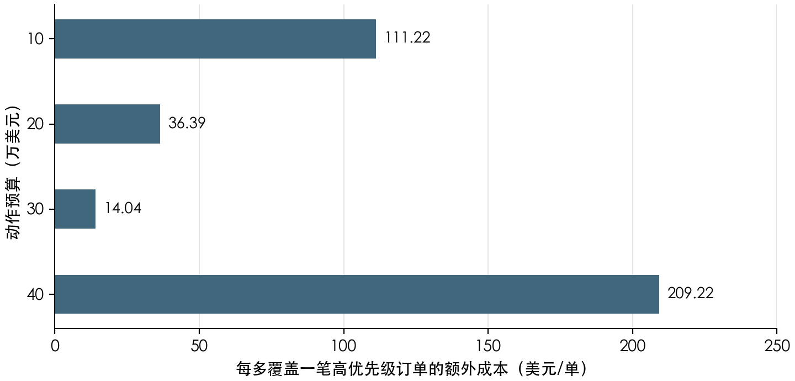
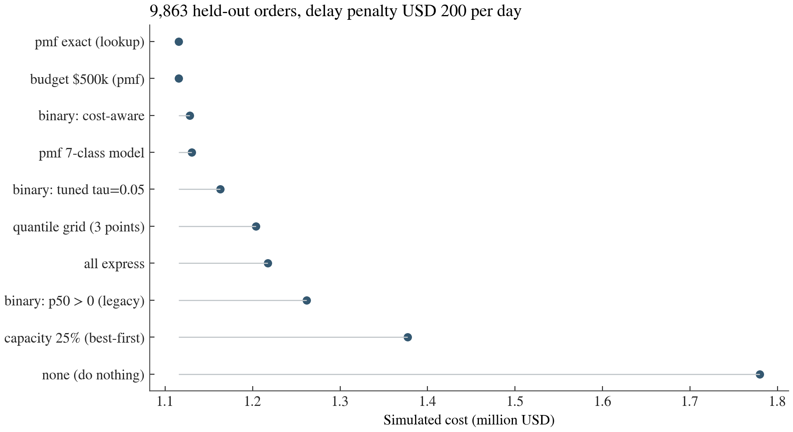

# 供应链交付分析：延迟预测与成本决策

[](https://github.com/lingtao-meng/supply-chain-ml-pipeline/actions/workflows/ci.yml)
[](LICENSE)

基于 DataCo 公开数据，分析订单时效偏差，并将预测分布转为通知、加急或不干预的选择。重点是订单级统计、时间切分、公平基准和统一成本比较。所有金额均为给定费用与干预效果下的离线计算。

## 分析结果

<!-- results:start -->
- DataCo：65,752 个订单，测试集 9,863 单。
- 二分类 AUC：0.7795；运输方式查表基准：0.7784。
- 给定动作与费用参数，历史分布查表策略成本 $1,115,520，较全量加急 $1,217,100 低 **8.35%**。
- 这是统一成本函数下的样本外离线比较；历史分布查表与机器学习模型分别报告。
<!-- results:end -->

完整策略表、默认与严格 as-of 口径、输入文件指纹见 [结果核对表](docs/RESULTS.md)。
第一次阅读可从 [一笔公开数据样本的完整分析](docs/WALKTHROUGH.md) 开始。



20 万美元预算下，按历史阈值优先干预能多覆盖 399 单，模拟成本多 14,520 美元。到 40 万美元档，这套规则已经覆盖全部高优先级订单，还有 56,400 美元未使用；按日释放的策略仍能把资金用于其他订单。不同预算对应不同的取舍。[逐日账与分界计算](docs/ARRIVAL_PACING.md)

## 数据与问题

- 数据：DataCo Supply Chain Dataset，180,519行明细、65,752个订单、54个原始字段。
- 标签：`delay_days = (shipping date − order date).days − scheduled days`，取值为 −2至4。
- 这里沿用公开数据字段构造时效偏差；发运日期不是签收日期，标签也不等同于客户实际OTIF。
- 一个订单包含多条商品明细，先按 `Order Id` 合并，再计算固定动作费，避免一单多次计费。
- 18维输入包含6个类别编码、5个日期特征和7个数值或交互特征；事后运输天数、交付状态和迟到标签不进入输入。

项目回答三个问题：可能晚多久、哪种处理动作成本更低、预算或处理数量受限时怎样排序。


## 方法与比较基准

| 环节 | 实现 | 核心检查 |
|---|---|---|
| 数据处理 | `src/pipeline.py` | 明细与订单分开；净额、数量和类别聚合可追溯 |
| 时间切分 | 订单日期70/15/15；可选 `--asof-purge` | 编码器、标准化仅拟合训练区；边界标签时点单列 |
| 预测 | 二分类、P10/P50/P90、七类PMF | 与训练期运输方式历史分布查表比较 |
| 决策 | `src/policy.py` | 所有模型使用相同费用与动作效果 |
| 验证 | 测试成本、配对bootstrap、容量/预算曲线 | 说明比较对象、样本单位与不确定性 |

PMF是七个延迟取值的概率，不是三个分位点的直线插值。查表PMF和七分类机器学习PMF分别报告；简单基准较强，是这份公开数据的分析发现。

| 动作 | 固定费（美元/单） | 设定效果 |
|---|---:|---|
| 不干预 | 0 | 不改变时效偏差 |
| 提前通知 | 20 | 剩余罚金乘0.6 |
| 加急 | 100 | 偏差减2天，罚金只计算剩余正延迟 |

基础罚金为200美元/天。实际标签为D时，动作成本为 `固定费 + 200 × 罚金系数 × max(D − 减少天数, 0)`；选动作时对预测分布求期望，评估时再代入测试标签。费用与效果均为分析参数。

## 从结果得到的判断

1. 运输方式历史基准与18特征模型的AUC接近；方式内部未观察到稳定的额外排序信号。这是当前数据和切分下的经验发现，不是理论信息上限。
2. 三点分位插值、七类模型和查表分布的成本不同；差异既来自分布表达，也来自参数与决策规则。
3. 公平二分类也应接同一成本决策层。早期 `p50 > 0` 规则保留为历史对照，不作为公平二分类的替代。
4. 预算分配使用贪心启发式，不保证一般整数分配问题的全局最优；容量按上限向下取整。
5. 事后已知每单标签的Oracle是成本下界；模拟uplift中的财务Oracle则是收益上界，两者方向不同。



## 复现

```bash
python -m venv .venv
source .venv/bin/activate
pip install -r requirements.txt
make data

# 正式训练、诊断、成本表、模型包
make reproduce

# 严格标签可得时点，独立保存
python scripts/refresh_cost_analysis.py --asof-purge --no-cache \
  --outdir results_asof --images images_asof --bundle models/model_bundle_asof.joblib

# 按订单重放分期预算，不依赖预训练模型包
make pacing
make arrival-pacing

# 核对已保存结果，更新结果说明
python scripts/verify_results.py --write
python scripts/verify_results.py
make test
```

`make reproduce` 执行主流水线；`make all` 还包括漂移、回本点、预算节奏、模拟A/B和uplift。`make fast` 与 `make smoke` 用于流程检查，不能替代正式训练结果。不同机器耗时不同，默认可能使用缓存；需要重新拟合时增加 `--no-cache`。

## 扩展分析与阅读入口

| 内容 | 入口 | 结果性质 |
|---|---|---|
| 成本、预算、容量、稳健性与bootstrap | `scripts/refresh_cost_analysis.py` | 公开订单标签与设定动作效果下的离线比较 |
| 回本点与样本量 | `scripts/intervention_analysis.py` | 给定效果和费用的情景计算 |
| 逐单到达与预算消耗 | `scripts/arrival_pacing.py` | [逐单回放](docs/ARRIVAL_PACING.md)，比较先到先处理、历史门槛与每日释放额度 |
| 多期预算节奏 | `scripts/pacing_simulation.py` | [订单级预算回放](docs/RESULTS.md#多期预算回放)，比较全期、按月和按周结转 |
| A/B与SRM | `scripts/ab_analysis.py` | 默认使用模拟分组与效果，按净成本区间作判断 |
| T-learner、Qini/AUUC与净收益排序 | `scripts/uplift_analysis.py` | 模拟异质效应，不当作DataCo已识别的因果效果 |
| CLI/API/Streamlit | `src/scoring.py`、`app/`、`api/` | 共享预处理与决策逻辑的可选演示 |

notebook保留早期探索；当前正式数字以脚本产物和结果核对表为准。项目的完善范围是公开数据分析、可复现计算与专业解释。

## 数据来源与许可

DataCo Supply Chain Dataset，使用仓库下载命令获取公开数据。原始数据许可归来源方；代码使用 [MIT License](LICENSE)。
