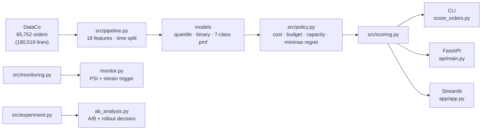
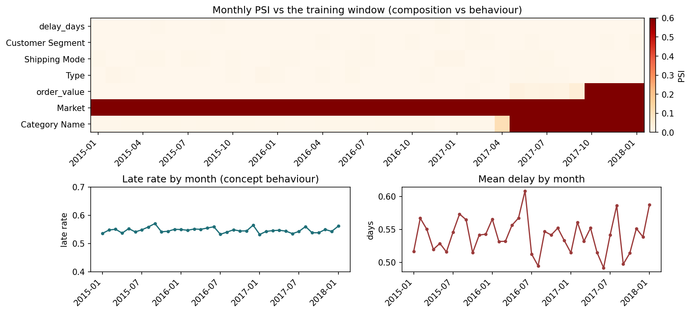
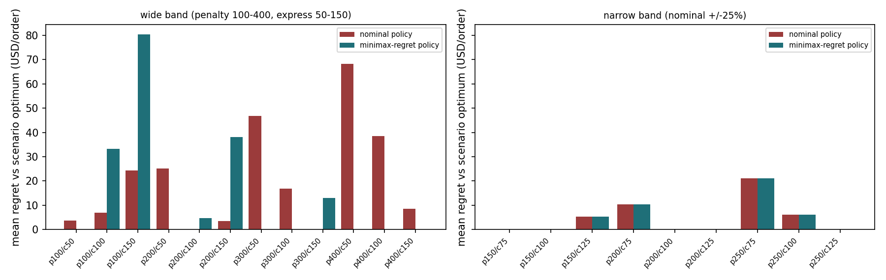
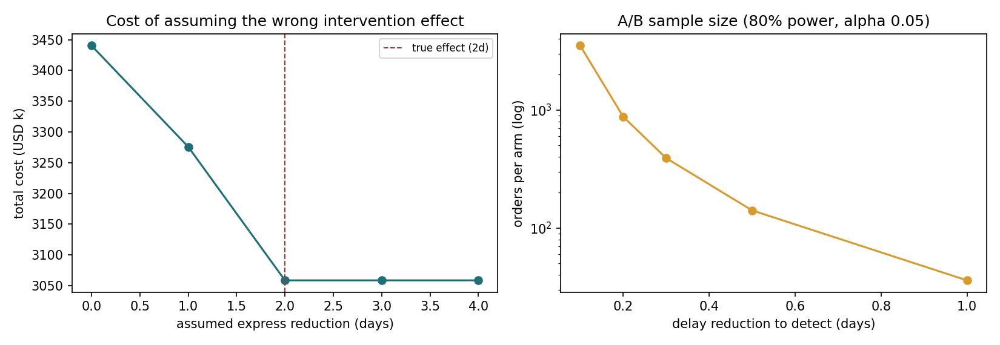
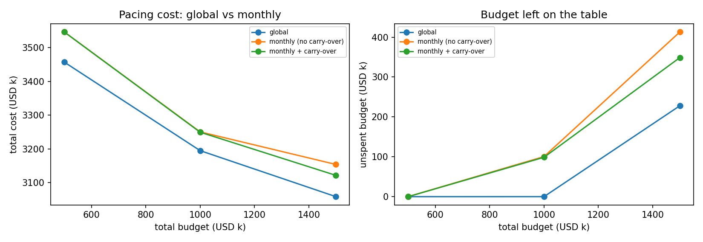
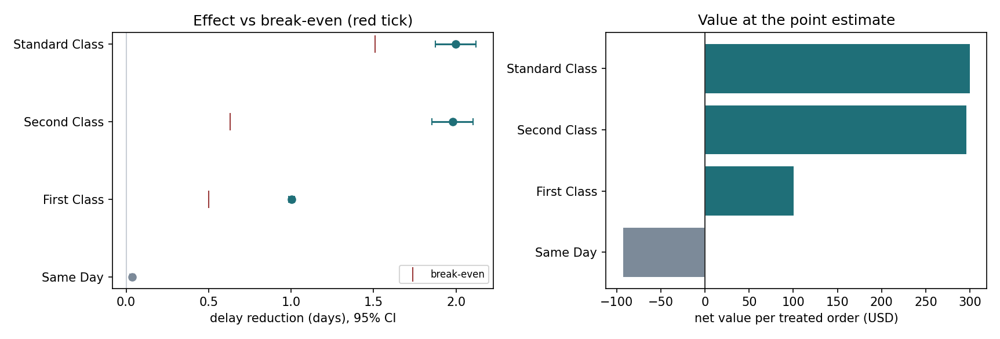
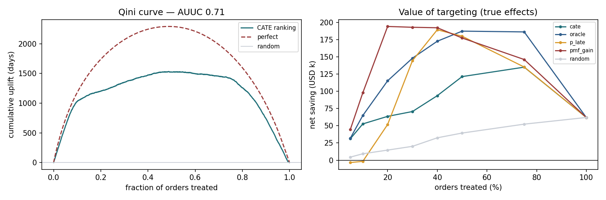

# 供应链延迟交付：把预测变成成本决策

[](https://github.com/lingtao-meng/supply-chain-ml-pipeline/actions/workflows/ci.yml)
[](https://opensource.org/licenses/MIT)
[](https://www.python.org/)

这是我在 DataCo 的 18 万条订单上做的一个项目。一开始想得很简单：预测哪些订单会晚，然后给高风险的订单加急。做着做着发现，模型能学到的东西比我预期少，而“值不值得加急”比“会不会晚”更影响结果。

仓库最后分成两块：预测层做 P10/P50/P90、迟到二分类和 7 类离散分布；决策层把动作、成本、预算和产能放进同一个函数里算。

复现全部数字大概三分钟：

```bash
make data        # 下载 91 MB 数据到 data/
make reproduce   # 训练 → 诊断 → 成本表 → results/ + 模型包
```

> **2026-10-27 完整重跑口径**：主流程按订单聚合，完整模式测试集 **9,863 单**，pmf 成本 **$1,115,520**。当前数字以 `results/summary.md` 和 `results/*.csv/json` 为准；文末标了“历史（line 口径）”的章节只作对照。CI 合成数据、分组 A/B、SRM 阻断、uplift 的 base_delay 和缓存键已修。

---

## 架构一览



`src/policy.py` 是唯一决定「动作成本怎么算」的地方，`src/scoring.py` 是唯一决定
「怎么把订单变成预测」的地方；脚本、API、App、测试全部复用这两个模块。

---

## 结论

> **v3 口径变更（2026-10-27）**：DataCo 的 180,519 行是**订单明细**，实际只有 **65,752 个订单**（2.75 行/单）。
> 此前所有成本按「行」计，同一个订单会被计费 2.75 次。现在改为**按订单聚合**后再算，
> 结论表与 `results/` 已全部重新生成；行口径可用 `--unit line` 复现，便于对照。
> 已完成订单口径重算：`summary.md` / `policy_comparison.csv` / `capacity_curve.csv` / `budget_curve.csv`。
> **仍是行口径**：`pacing.csv` / `ab_*.csv` / `uplift*.csv`（独立脚本，尚未重跑），引用前需先重算。

1. **0.78 的 AUC 不是模型没调好。** 只用运输方式查表就有 0.7784，18 个特征的模型是 0.7795（差 +0.0011）；把方式拆开看，方式内部 AUC 只有 0.50 左右，卡方检验也查不出残余关联（Standard Class 内部 Market p=0.994、Category p=1.000、Segment p=0.718）。延迟是方式内部均匀随机的，0.78 就是这份数据的信息上限。
2. **延迟只有 -2 到 4 七个整数。** 用 P10/P50/P90 三个点去拼分布，会把一条平坦的分布拉成连续直线。同样的测试集，三点插值 $1.2035M，直接建 7 类分布 $1.1303M，差了 6.1%。
3. **我原来写“分位数回归比二分类好 34%”，这个结论站不住。** 旧基线是 `p50>0` 就加急，在 $100 加急成本下约等于全量加急。给二分类同样的期望成本决策层，成本是 $1.1281M，和 7 类 pmf 只差 1.1%。
4. **决定成本的主要不是模型，是决策规则和成本参数。** 同一批订单，11 个策略从 $0.771M 到 $1.780M；罚金从 $100 改到 $400，加急比例能从 0% 跳到 94%。
5. **参数再不确定一点，模型会消失。** 宽区间（罚金 $100–400、加急 $50–150）下 minimax regret 退化成“除 Same Day 外全加急”；窄区间（±25%）下基准策略本身就是最优。
6. **干预效果我没法从这份数据里估出来。** 所以只算了回本点和做 A/B 需要的样本量。注意：`ab_analysis` 那一组回本天数还是旧口径（未重跑），引用前需先重算。

> v1 的两个口径问题（`p50>0` 的假基线、三点插值当分布）在文末「从 v1 到 v2」里有记录。

---

## 要回答的问题

订单晚了要赔钱，加急也要花钱，所以实际要决定的是三件事：

1. 这单大概会晚几天？只看一个点不够，得知道分布。
2. 值不值得为它花钱？加急多少钱，晚一天赔多少。
3. 只能加急一部分时，先给谁？

把这三个问题放进同一个成本函数，才能比较模型、规则和“什么都不做”。

---

## 数据

DataCo Supply Chain Dataset（Kaggle 公开数据）。180,519 行订单明细（65,752 个订单），54 个字段，2015-01-01 → 2018-01-31。

- 迟到率 **54.7%**，平均延迟 0.54 天，累计延迟 16.3 万天
- 目标：`delay_days = 实际运输天数 − 承诺运输天数`
- 延迟取值只有 **−2, −1, 0, 1, 2, 3, 4** 七个整数
- `Days for shipping (real)`、`Delivery Status`、`Late_delivery_risk` 都是事后字段，**全部排除**

---

## 方法

| 环节 | 做法 |
|---|---|
| 特征 | 18 维，仅下单时点可得：日期派生、金额/折扣、交互项、类别编码 |
| 切分 | 按订单日期 70/15/15，训练用过去、测试用未来（非随机切分） |
| 分布模型 | `GradientBoostingRegressor(loss="quantile")` × P10/P50/P90；`HistGradientBoostingClassifier` 7 类 pmf |
| 决策 | 对每个动作算 `E[cost] = 动作成本 + 罚金 × 系数 × E[(D − 减天数)+]`，取最小 |
| 评估 | 统一成本函数 + 配对 bootstrap 置信区间 + 产能曲线 |

**动作菜单**

| 动作 | 固定成本 | 效果 |
|---|---|---|
| 不干预 | $0 | — |
| 提前通知 | $20 | 罚金 × 0.6 |
| 加急 | $100 | 减 2 天 |

---

## 历史结果（line 口径，仅作对照）

> 下面结果 1–14 大多是旧 line 口径。当前 order 口径结果看本文开头的 v3 说明和 `results/summary.md`。

## 结果 1：0.78 是信息天花板


- 运输方式基线的 AUC 是 **0.7784**，18 特征模型是 **0.7787**，差 +0.0003
- 拆开看：`Second Class` 内部 AUC **0.5012**，`Standard Class` 内部 **0.5008**
- 卡方检验（Standard Class 内部，n=107,752）：Market p=0.106 / V=0.007，Category p=1.000 / V=0.017，Segment p=0.071 / V=0.008

原因很直接：这个数据集的运输天数在每个运输方式内部近似**均匀随机生成**——
Standard Class 的延迟在 −2..2 各占约 20%，Second Class 在 0..4 各占约 20%。
0.78 不是模型失败，是运输方式已经把能解释的都解释完了。

> **这条诊断比多 0.01 AUC 更有用**：它说明继续做特征工程是在拟合噪声，
> 也解释了为什么 SHAP 里 `Shipping Mode` 的贡献是第二名的 50 倍。

---

## 结果 2：统一成本函数下的 11 个策略

测试集 9,863 单，罚金 $200/天，加急 $100/单：

| 策略 | 总成本 | 单均成本 | 干预率 | 通知 | 加急 | 迟到召回 | 命中率 |
|---|---|---|---|---|---|---|---|
| 事后最优（upper bound） | $771,400 | $78.21 | 54.8% | 388 | 5,018 | 100.0% | 100.0% |
| **pmf 精确（运输方式分布）** | **$1,115,520** | **$113.10** | 94.5% | 5,888 | 3,436 | 100.0% | 58.0% |
| **预算 $500k（pmf 增量贪心）** | **$1,115,520** | **$113.10** | 94.5% | 5,888 | 3,436 | 100.0% | 58.0% |
| 二分类 + 成本决策层 | $1,116,600 | $113.21 | 94.5% | 5,825 | 3,499 | 100.0% | 58.0% |
| pmf 7 类模型 | $1,126,480 | $114.21 | 94.5% | 4,133 | 5,191 | 100.0% | 58.0% |
| 二分类 + 验证集调阈值 | $1,163,200 | $117.94 | 94.5% | 0 | 9,324 | 100.0% | 58.0% |
| **分位网格（3 点插值）** | **$1,205,100** | **$122.18** | 99.8% | 5,737 | 4,104 | 99.9% | 54.9% |
| 全量加急 | $1,217,100 | $123.40 | 100% | 0 | 9,863 | 100.0% | 54.8% |
| 二分类 `p50 > 0`（旧基线） | $1,225,600 | $124.26 | 93.9% | 0 | 9,264 | 95.8% | 55.9% |
| 产能 25%（按期望收益排序） | $1,377,000 | $139.61 | 25.0% | 0 | 2,466 | 38.6% | 84.6% |
| 不干预 | $1,779,600 | $180.43 | 0% | 0 | 0 | 0% | — |

> 订单一档下，预算 $500k 不再真正约束（成本下降后 50 万美元覆盖得下最优解），所以它和 pmf 精确解重合。

几个差距：

- 不干预 → pmf：**−37.4%**
- 3 分位插值 → pmf：**−6.1%**（$199,560）
- 旧的 `p50>0` 基线 → pmf：**−8.9%**
- 公平二分类 → pmf：**−0.35%**（$10,600，统计显著但业务上可忽略）
- 事后最优 → pmf：还有 44% 的差距，这部分来自**单笔延迟的不可预测性**，不是决策规则能补的


### 配对 bootstrap（相对 pmf 精确策略，单均成本）

| 策略 | Δ$/单 | 95% CI |
|---|---|---|
| pmf 7 类模型 | +0.38 | [+0.10, +0.67] |
| 二分类 + 成本决策层 | +0.39 | [+0.18, +0.59] |
| 二分类调阈值 | +5.03 | [+4.15, +5.87] |
| 分位网格 | +7.37 | [+7.17, +7.58] |
| 全量加急 | +10.64 | [+9.75, +11.55] |
| 旧 `p50>0` 基线 | +11.06 | [+10.15, +11.95] |
| 预算 $500k | +14.71 | [+14.20, +15.19] |
| 不干预 | +67.35 | [+66.06, +68.59] |

3% 量级的差距在 2.7 万单上也可能显著，所以每个结论都带区间：
pmf 与公平二分类的差距虽然显著，但 **$0.39/单 ≈ 0.35%**，不足以支撑「分位数回归更好」的叙事。

---

## 结果 3：为什么 3 个分位点不够


左图是 Standard Class 的真实延迟分布（5 个原子，各约 20%）；右图是模型用 P10/P50/P90
重建出的 CDF。三点插值把一条**平坦的离散分布**拉成了连续直线，尾部被系统性高估：

- 决策规则里要算 `E[(D−2)+]`，真实分布下是 `(0+0+1+2)/5 = 0.6` 天
- 三点插值给出的尾部形状不同，导致 99.8% 的订单被干预（真实最优是 94.4%）

直接建模 7 类概率后，`E[(D−r)+] = Σ p_d · max(d−r, 0)` 是精确的，成本降到 $1.126M。
这也是整个项目里唯一一处“换模型真能省钱”的地方，省 6.1%。

---

## 结果 4：参数灵敏度——什么时候值得做模型

固定加急 $100 时，改变罚金；以及固定罚金 $200 时，改变加急成本。表里是 pmf 相对 3 分位插值的降本：

| 罚金 \ 加急 | $50 | $100 | $150 |
|---|---|---|---|
| $100/天 | +0.3% | +0.1% | +0.1% |
| $200/天 | +3.9% | +6.1% | +0.9% |
| $300/天 | +3.3% | +1.1% | +5.2% |
| $400/天 | +2.9% | +0.9% | +0.8% |


20 组参数里 pmf 一次都没有输给 3 分位插值（0.07%–8.2%）。
但 pmf 相对**公平二分类**的差距只有 −0.005% 到 +2.6%，其中 4 组参数下二分类反而最优——
这说明**模型类别的选择在这个数据集上无关紧要，分布表示和决策规则才重要**。

旧 README 里「加急 $100、罚金 $100/天时降本 34%」的数字，来自把二分类基线设成
「p50>0 就加急」；那个基线在 $100 加急成本下等于「几乎全量加急」，当然会输 34%。

---

## 结果 5：产能一紧，排序才开始值钱


| 可加急比例 | pmf 成本 | 分位成本 | pmf 召回 | 分位召回 |
|---|---|---|---|---|
| 10% | $1,602,200 | $1,600,400 | 14.6% | 14.6% |
| 25% | **$1,377,000** | $1,422,880 | **38.6%** | 32.5% |
| 50% | **$1,239,040** | $1,364,280 | **67.4%** | 50.9% |
| 75% | **$1,169,220** | $1,294,380 | **85.9%** | 69.4% |
| 100% | $1,115,520 | $1,205,100 | 100% | 99.9% |

产能越紧，排序质量越重要：25% 产能下 pmf 的召回比 3 分位高 6.1 个百分点，
到 50% 时高 16.5 个百分点——因为分位插值把太多订单排在「伪高风险」区间。

---

## 结果 6：预算约束——先花在哪


| 预算 | 总成本 | 通知 | 加急 | 召回 | 说明 |
|---|---|---|---|---|---|
| $0 | $1,779,600 | 0 | 0 | 0% | 不干预 |
| $100k | $1,376,800 | 5,000 | 0 | 67.8% | 只够通知 |
| $250k | $1,222,480 | 8,530 | 794 | 100% | 开始升级加急 |
| $500k | **$1,115,520** | 5,888 | 3,436 | 100% | 已达无约束最优（实花 $461k） |
| $750k / $1M | $1,115,520 | 5,888 | 3,436 | 100% | 预算不再构成约束 |

预算曲线用的是**增量贪心**：从「不干预」出发，每次选边际收益/边际成本最高的下一步，
并允许 `通知 → 加急` 的 $80 升级。朴素的「每单只选一个动作」版本会丢掉升级收益：
$1M 预算下它只花得出 $511k，成本停在 $3.44M，而增量贪心能花到 $1M、成本降到 $3.19M。

---

## 结果 7：决策是成本结构的阶跃函数


同一个模型、同一批订单，只改「罚金/加急」两个参数，加急比例就会从 0% 跳到 94%：

| 罚金 \ 加急 | $50 | $100 | $150 |
|---|---|---|---|
| $100/天 | 94% | 0% | 0% |
| $200/天 | 94% | 35% | 0% |
| $300/天 | 94% | 94% | 35% |
| $400/天 | 94% | 94% | 94% |

剩下 6% 是 Same Day 订单——它们本来就不会延迟，任何参数下都不该加急。
所以干预率不是模型属性，是成本参数的函数。别急着比模型，先把钱的口径对清楚。

### 成本模型假设（比模型选择更重要）

| 成本模型 | 中位罚金/天 | 干预率 | 加急率 |
|---|---|---|---|
| 固定 $200/天（本文基准） | $200 | 94.4% | 35.1% |
| 订单金额 1%/天，最低 $20 | $20 | 0% | 0% |

中位订单金额只有 **$180**：1%/天 = $1.8，最低 $20 仍远低于 $100 的加急成本，所以最优动作是全部不干预。
所以“该干预 94% 的订单”这个结论，是 $200/天这个假设带出来的。真实部署第一步应该和业务把罚金、
加急成本对清楚，而不是继续调模型。`src/policy.py` 已支持逐单罚金数组，`results/cost_model_check.csv` 可复现这张表。

---

## 结果 8：漂移监控——构成漂移，不是行为漂移



以训练窗口（前 70%，截至 2017-01-08）为基准，按月计算 PSI（<0.1 稳定，>0.25 显著）：

| 特征 | 参考期后最大 PSI | 判定 |
|---|---|---|
| `Category Name` | 23.17 | 高 |
| `Market` | 11.04 | 高 |
| `order_value` | 4.66 | 高 |
| `Shipping Mode` | 0.005 | 稳定 |
| `Customer Segment` / `Type` | 0.005 / 0.006 | 稳定 |
| **`delay_days`（目标）** | **0.002** | **稳定** |

迟到率每个月都在 **53%–56%**，平均延迟 0.50–0.61 天，几乎是一条平线。
所以 notebook 里对抗验证 AUC=1.0，不是因为特征和延迟的关系变了，是样本构成变了：
Market 在 2016 年切到 USCA / Pacific Asia，2017 年又切回 Europe / LATAM；Category 在 2017 年后也换了分布。

这类漂移应该靠时间切分、重加权或按市场分层处理，而不是重新训练一个「更懂延迟」的模型——
因为目标本身没有漂移。复现：`make drift`，输出 `results/drift_report.csv`、`results/drift_summary.json`。

---

## 结果 9：成本参数不确定时的鲁棒决策



基准策略在 $200/天、加急 $100 时最优。如果这两个数本身不确定，可以用 minimax regret：
对每单选「最坏情景下后悔值最小」的动作（后悔 = 相对该情景最优动作多花的钱）。

| 不确定性区间 | 最坏后悔（基准） | 最坏后悔（鲁棒） | 名义情景溢价 | 鲁棒动作分布 |
|---|---|---|---|---|
| 宽（$100–400/天，$50–150） | $92.22/单 | **$80.31/单** | +$136,200 | 不干预 6% / 通知 0% / 加急 94% |
| 窄（±25%） | $26.08/单 | $26.08/单 | $0 | 6% / 59% / 35% |

宽区间下鲁棒策略退化成「除 Same Day 外全加急」：最坏后悔降 13%，但名义情景多花 $136k。
窄区间下基准策略本身就是 minimax 最优。鲁棒性值不值，取决于你对成本参数有多不确定。不确定性足够大时，模型会消失，只剩一个对冲规则。

---

## 结果 10：干预效果是假设——回本点与 A/B 样本量



数据里没有处理组/对照组，所以「加急减 2 天」无法从数据估计。能做的两件事：

**① 回本点**（$200/天、加急 $100）

| 运输方式 | E[延迟+] | 加急至少要减 |
|---|---|---|
| First Class | 1.00 天 | 0.50 天 |
| Second Class | 2.00 天 | 0.63 天 |
| Standard Class | 0.60 天 | **1.51 天** |
| Same Day | 0 天 | 永不回本 |

**② 假设错了要付多少**：若真实效果是 2 天，但策略只假设 0 / 1 天，成本升到 $3.44M / $3.28M；
假设 ≥2 天时策略不再变化（$3.06M）。**低估效果比高估更贵。**

**③ 做 A/B 需要多大样本**（延迟 SD 1.50 天，80% power，α=0.05）：

| 要检测的缩短 | 每组订单数 |
|---|---|
| 0.1 天 | 3,511 |
| 0.2 天 | 878 |
| 0.5 天 | 141 |

检测 0.2 天需要约 878 单/组——这个量级在真实业务里是可做的，也是把「假设」变成「证据」的最小实验。

---

## 结果 11：多期预算节奏——一次性分配有多贵



测试期 8 个月。把预算按月释放，和一次性全局分配比：

> ⚠️ 下表与下面几组结果（pacing / A/B / uplift）**仍是行口径**——它们由独立脚本生成，尚未按订单重跑。可以和上文对照看趋势，但**不要和订单口径的金额相加或比较**。

| 总预算 | 全局（有前瞻） | 月度（不结转） | 月度 + 结转 |
|---|---|---|---|
| $500k | $3,457,000 | $3,546,280 | $3,546,240 |
| $1M | $3,194,960 | $3,250,440 | $3,249,560 |
| $1.5M | $3,058,600 | $3,153,960 | $3,121,640 |

$500k 时差距最大：月度节奏的迟到召回只有 85%，全局是 98.5%——预算紧时，早期月份会把钱花在
「当时看起来最值」的订单上，后面真正高收益的订单没钱了。结转能回收约 $32k（$1.5M 时），
但补不回信息差。

---

## 结果 12：在线监控——什么时候该重训练

`scripts/monitor.py` 把 PSI 做成可接 cron 的检查，输出三种动作：

| 条件 | 动作 | 退出码 |
|---|---|---|
| 目标分布 PSI > 0.25 | retrain | 2 |
| 仅特征 PSI > 0.25 | reweight / segment | 1 |
| 其他 | monitor / stable | 0 |

在真实切分上（前 70% 参考、后 30% 新批次）：Market / Category 高漂移，
`delay_days` PSI **0.0001**，建议 **reweight**（不是重训练）。这正对应结果 8：
构成变了，行为没变。

---

## 结果 13：A/B 分析框架——把假设变成可检验的结论



观察数据没法估计“加急到底减几天”。这个框架只管三件事：

1. **估计**：Welch t 检验给出 reduction 和 95% CI；
2. **防呆**：SRM 检查（随机化比例失衡时，任何效应都不可信）；
3. **决策**：按运输方式分层，用 **CI 下界 vs 回本点** 判断——下界高于回本点才上线，
   上界低于回本点则不上，跨过回本点则「不明确，继续收集」。

没有真实实验数据，所以内置模拟器从实际延迟分布生成 A/B（已知效果），验证估计器与决策规则：

| 运输方式 | 模拟真实效果 | 估计 [95% CI] | 回本点 | 决策 | 每单净价值 |
|---|---|---|---|---|---|
| First Class | 1.00d | 1.00 [0.99, 1.02] | 0.50d | 上线 | +$101 |
| Second Class | 2.00d | 1.98 [1.85, 2.10] | 0.63d | 上线 | +$296 |
| Standard Class | 2.00d | 2.00 [1.87, 2.12] | 1.51d | 上线 | +$300 |
| Same Day | 0.05d | 0.04 [0.02, 0.05] | 永不 | 不上线 | −$93 |

不只有点估计：200 次重复模拟的 CI 覆盖率是 **95.5%**，说明区间不是装饰。
真实实验接进来只需 `python scripts/ab_analysis.py --input ab_test.csv`
（列：`delay_days`、`treated`，可选 `shipping_mode`）。

---

## 结果 14：异质效应与定向干预——风险高 ≠ 值得干预



前面所有策略都假设「加急对所有订单都减 2 天」。现实中效果因订单而异：高价值、慢运输方式的
订单受益更大，Same Day 订单几乎没收益。用 T-learner 估计 CATE，用 Qini/AUUC 评估排序，
再用真实效应算定向干预的净节省：

| 定向比例 | CATE（uplift） | p_late（风险） | pmf_gain（恒定效应） | 随机 | Oracle |
|---|---|---|---|---|---|
| 10% | **$1.06M** | $0.21M | $0.64M | $0.50M | $1.21M |
| 20% | **$2.04M** | $0.61M | $1.22M | $0.99M | $2.18M |
| 30% | **$2.80M** | $1.19M | $1.43M | $1.47M | $2.95M |

AUUC **0.83**（模拟中加入不可观测的异质性，避免“完美排序”的假象）。

最反直觉的结论：**按迟到风险排序，在三个比例下都比随机还差**。因为高风险集中在
Second/Standard 的低价值订单——它们“容易晚”，但加急对它们的效果并不大；而高价值订单
效果更高、风险却不一定高。风险模型回答“会不会晚”，uplift 回答“干预有没有用”，这俩不是一回事。

> 注意：这是模拟验证，不是 DataCo 的真实 CATE。真实场景需要结果 13 的 A/B 数据来训练 uplift。

---

## 三个入口：脚本 / HTTP / UI

| 入口 | 命令 | 适合 |
|---|---|---|
| 批量 CLI | `python scripts/score_orders.py --input orders.csv --out plan.csv --budget 500000` | 离线跑批 |
| HTTP API | `uvicorn api.main:app --port 8000` | 接上游系统 |
| Streamlit | `streamlit run app/app.py` | 单笔演示 + 批量上传 |

三个入口共用 `src/scoring.py`，不会出现「demo 和脚本判断不一致」。

```bash
curl -s localhost:8000/score -H 'content-type: application/json' -d '{
  "orders": [{
    "type": "DEBIT", "category_name": "Fishing", "department_name": "Fan Shop",
    "market": "Europe", "shipping_mode": "Second Class", "customer_segment": "Consumer",
    "order_date": "2017-12-15", "scheduled_days": 2, "quantity": 3,
    "unit_price": 80, "discount_rate": 0.1
  }],
  "penalty": 200
}'
```

```bash
make reproduce                 # 先生成 models/model_bundle.joblib
docker build -t delay-api .
docker run -p 8000:8000 delay-api
```

---

## 复现

```bash
python -m venv .venv && source .venv/bin/activate
pip install -r requirements.txt
pip install -r requirements-service.txt   # 只有跑 HTTP API / Docker 时需要

make data        # 或手动放 data/DataCoSupplyChainDataset.csv
make reproduce   # 全部数字：results/ + images/ + models/model_bundle.joblib
make test        # 107 个单测，不需要数据集
make smoke       # 合成数据端到端（CI 同款）
make drift       # 月度 PSI 漂移报告
make app         # Streamlit 演示（单笔 + 批量）
make api         # FastAPI：uvicorn api.main:app --port 8000
make pacing      # 多期预算节奏
make intervention # 干预回本点 + A/B 样本量
make monitor REF=reference.csv CUR=new.csv   # PSI 监控（退出码 0/1/2）
make ab          # A/B 分析（默认模拟；--input 接真实实验）
make uplift      # 异质效应 + 定向干预

# 批量评分：CSV → 预测 + 建议动作 + 期望成本
python scripts/score_orders.py --input orders.csv --out plan.csv --budget 500000
```

- 首次训练分位模型约 2 分钟，之后走缓存；缓存键包含数据指纹、超参、特征/成本模块源码指纹，改代码会自动失效
- 数据路径会自动查找：`--data` → `data/` → kagglehub 缓存
- `python scripts/refresh_cost_analysis.py --fast` 用微型模型跑通全链路（真实数据约 30 秒）
- 单笔决策演示：`streamlit run app/app.py`（加载真实模型包，无随机数）

---

## 项目结构

```
src/pipeline.py                    数据加载、18 维特征、时间切分、编码器
src/policy.py                      统一成本函数、11 个策略、pmf/预算/鲁棒决策、bootstrap
src/scoring.py                     共享评分：CLI / API / App 同一套逻辑
src/monitoring.py                  PSI、告警级别、重训练建议
src/experiment.py                  A/B：Welch、SRM、分层效应、模拟器
src/uplift.py                      T-learner、Qini/AUUC、定向干预曲线
scripts/refresh_cost_analysis.py   一键复现：训练 → 天花板诊断 → 成本表 → 模型包
scripts/score_orders.py            批量评分：CSV → 预测 + 建议动作 + 期望成本
scripts/drift_report.py            月度 PSI 漂移报告（构成 vs 行为）
scripts/monitor.py                 在线 PSI 检查（cron 友好，带退出码）
scripts/intervention_analysis.py   回本点、效果误设成本、A/B 样本量
scripts/pacing_simulation.py       多期预算节奏模拟
scripts/ab_analysis.py             A/B 分析（真实输入或模拟验证）
scripts/uplift_analysis.py         异质效应与定向干预
api/main.py                        FastAPI /score 服务
Dockerfile                         容器镜像
app/app.py                         Streamlit：输入订单 → 分布 → 期望成本 → 动作
tests/                             107 个单测 + 合成数据夹具（CI 用）
notebooks/                         探索过程（成本口径已统一到 src/policy.py）
results/                           summary.md、policy_comparison.csv、bootstrap.csv、budget_curve.csv、drift_report.csv…
images/                            13 张由脚本生成的图 + notebook 探索图
```

---

## 从 v1 到 v2（改了什么）

v2 是对 v1 的**修正与补强**，不是重写。旧的预测数字全部原样复现
（AUC 0.7787、分位策略 $1,205,100、旧二分类 $1,225,600、不干预 $1,779,600），
变化都在「比较方式」和「工程可信度」上：

| # | v1 的问题 | v2 的修法 |
|---|---|---|
| 1 | **Streamlit app 是假模型**：硬编码权重 + `np.random.normal` 噪声，却写着 XGBoost / AUC 0.744 | 删除假逻辑；脚本导出真实模型包，app 加载后输出真实分位、真实 pmf、真实期望成本 |
| 2 | **notebook 与 README 成本口径冲突**：notebook 显示 $628K / $509K / 省 $119K，README 是 $3.26M / $3.36M | notebook 第 5、6 节改为调用 `src/policy.py`，全量重跑，结论与 README 一致 |
| 3 | **二分类基线是稻草人**：`p50 > 0` 就加急 | 加入「二分类 + 同一期望成本决策层」和「验证集调阈值」两个公平基线 |
| 4 | **3 分位插值被当作分布** | 直接建模 7 类 pmf；用精确 `E[(D−r)+]` 决策，省 6.1% |
| 5 | 差异只有点估计，没有不确定性 | 配对 bootstrap 置信区间 |
| 6 | `requirements.txt` 锁死旧版本，Python 3.12 装不上 | 改为版本区间；新增 `requirements-dev.txt` / `requirements-notebook.txt` |
| 7 | CI 只跑 10 个单测 | ruff + 3.10/3.12 单测 + 合成数据端到端 + Streamlit 冒烟 |
| 8 | 缓存只看「文件在不在」，改特征会静默复用旧模型 | 缓存键包含数据指纹、超参和版本 |
| 9 | app 需要的 `best_model.pkl` 从不存在，clone 下来必然报错 | 模型包由复现脚本生成，路径与 app 对齐 |

v2.1 又补了四块：**预算约束的增量贪心**（修掉了「每单只选一个动作」丢掉升级收益的问题）、
**批量评分 CLI**（`scripts/score_orders.py`）、**决策地图**（干预率随成本参数的阶跃变化），
以及**月度 PSI 漂移报告**（区分构成漂移与行为漂移）。测试从 33 增加到 55。

v2.2 再把决策层做厚：**共享评分模块**（CLI / FastAPI / Streamlit 同一套逻辑）、
**minimax-regret 鲁棒决策**、**干预效果回本点与 A/B 样本量**、**多期预算节奏**、
**可接 cron 的 PSI 监控**，以及 Docker 镜像。测试 55 → 84。

v2.3 再补上 **A/B 分析框架**（Welch + SRM + 分层 + 模拟器 + 上线决策），测试 84 → 98。

v2.4 补上 **uplift / 定向干预**（T-learner + Qini/AUUC + 成本曲线），测试 98 → 104。

---

## 局限与下一步

**方法层面**

1. **罚金口径是假设，不是事实**：固定 $200/天时干预率 94.4%，换成「订单金额 1%/天（最低 $20）」后干预率 0%。所以本文的绝对金额不能直接外推；真实部署要先和业务校准罚金与加急成本。
2. **干预效果是假设**：加急减 2 天、通知罚金 ×0.6 都没有因果证据。真实场景需要 A/B 或 uplift 模型估计异质处理效应。
3. **数据本身没有单笔信号**：换成有真实运营信息的数据（承运商、线路、仓库、天气、节假日）才有 ML 的用武之地。
4. **pmf 模型是 HistGB 7 分类**：可以对比有序回归（ordinal）、LightGBM/CatBoost 多分类、conformal 预测集。
5. **产能/预算曲线是静态一次性分配**：结果 11 的月度节奏只是简化版，真实调度还有补货、承诺时效窗口和多级网络。

**工程层面**

6. **服务化只到 demo 级**：已有 FastAPI / Docker / 批量上传，但缺鉴权、限流、可观测性和异步队列。
7. **没有实验追踪与数据版本**：可接 MLflow + DVC，把每次成本表和数据指纹绑定。
8. **漂移监控已能告警（monitor CLI），但还没接调度器**：下一步接 cron/Airflow、按市场分层告警，并和重训练流水线联动。

---

## License

MIT
