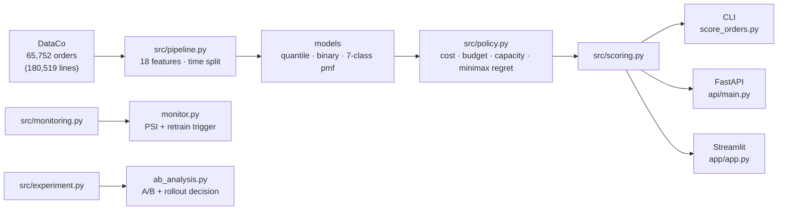

# 供应链延迟交付：把预测变成成本决策

[](https://github.com/lingtao-meng/supply-chain-ml-pipeline/actions/workflows/ci.yml)
[](https://opensource.org/licenses/MIT)
[](https://www.python.org/)

> **项目定位**：基于公开数据的离线分析与方法验证，不是企业上线系统。验收看数据口径、时间切分、比较基准、计算结果和报告表述；HTTP API、Streamlit、Docker、批量上传属于可选工程，不作为项目完成门槛。

这是我在 DataCo 的 18 万条订单明细上做的一个项目。一开始想得很简单：预测哪些订单会晚，然后给高风险的订单加急。做着做着发现，模型能学到的东西比我预期少，而“值不值得加急”比“会不会晚”更影响结果。

仓库最后分成两块：预测层做 P10/P50/P90、迟到二分类和 7 类离散分布；决策层把动作、成本、预算和产能放进同一个函数里算。

复现全部数字大概三分钟：

```bash
make data        # 下载 91 MB 数据到 data/
make reproduce   # 训练 → 诊断 → 成本表 → results/ + 模型包
```

> **2026-10-27 完整重跑口径**：主流程按订单聚合，完整模式测试集 **9,863 单**，pmf 成本 **$1,115,520**。当前数字以 `results/summary.md` 和 `results/*.csv/json` 为准。CI 合成数据、分组 A/B、SRM 阻断、uplift 的 base_delay 和缓存键已修。
>
> **标签可得时点**：默认仍是按订单日期切分的固定离线回放；严格 as-of 试跑用 `--asof-purge`，剔除训练/验证边界上结果尚未产生的样本。当前保留训练 45,820/46,026、验证 9,658/9,863，测试集不变；结果在 `results_asof/`。

---

## 架构一览



`src/policy.py` 是唯一决定「动作成本怎么算」的地方，`src/scoring.py` 是唯一决定
「怎么把订单变成预测」的地方；脚本、API、App、测试全部复用这两个模块。

---

## 结论

> **v3 口径变更（2026-10-27）**：DataCo 的 180,519 行是**订单明细**，实际只有 **65,752 个订单**（2.75 行/单）。
> 此前所有成本按「行」计，同一个订单会被计费 2.75 次。现在改为**按订单聚合**后再算，
> 结论表与 `results/` 已全部重新生成；行口径可用 `--unit line` 复现，便于对照。
> 已完成订单口径重算：`summary.md` / `policy_comparison.csv` / `capacity_curve.csv` / `budget_curve.csv`。
> **口径**：`pacing.csv` 仍是行口径；`ab_*.csv` / `uplift*.csv` 已按订单口径重跑。

1. **0.78 的 AUC 不是模型没调好。** 只用运输方式查表就有 0.7784，18 个特征的模型是 0.7795（差 +0.0011）；把方式拆开看，方式内部 AUC 只有 0.50 左右，卡方检验也查不出残余关联（Standard Class 内部 Market p=0.994、Category p=1.000、Segment p=0.718）。这份数据的延迟在方式内部近似均匀生成，所以 0.78 更像当前特征下的上限，而不是调参问题；它不能证明所有可能特征的理论上限。
2. **延迟只有 -2 到 4 七个整数。** 用 P10/P50/P90 三个点去拼分布，会把一条平坦的分布拉成连续直线。同样的测试集，三点插值 $1.2035M，直接建 7 类分布 $1.1303M，差了 6.1%。
3. **我原来写“分位数回归比二分类好 34%”，这个结论站不住。** 旧基线是 `p50>0` 就加急，在 $100 加急成本下约等于全量加急。给二分类同样的期望成本决策层，成本是 $1.1281M，和 7 类 pmf 只差 1.1%。
4. **决定成本的主要不是模型，是决策规则和成本参数。** 同一批订单，11 个策略从 $0.771M 到 $1.780M；罚金从 $100 改到 $400，加急比例能从 0% 跳到 94%。
5. **参数再不确定一点，模型会消失。** 宽区间（罚金 $100–400、加急 $50–150）下 minimax regret 退化成“除 Same Day 外全加急”；窄区间（±25%）下基准策略本身就是最优。
6. **干预效果我没法从这份数据里估出来。** 所以只算了回本点和做 A/B 需要的样本量。注意：`ab_analysis` 那一组回本天数还是旧口径（未重跑），引用前需先重算。

> 旧版的两个口径问题（`p50>0` 的假基线、三点插值当分布）已在当前结果中修正。

---

## 要回答的问题

订单晚了要赔钱，加急也要花钱，所以实际要决定的是三件事：

1. 这单大概会晚几天？只看一个点不够，得知道分布。
2. 值不值得为它花钱？加急多少钱，晚一天赔多少。
3. 只能加急一部分时，先给谁？

把这三个问题放进同一个成本函数，才能比较模型、规则和“什么都不做”。

---

## 数据

DataCo Supply Chain Dataset（Kaggle 公开数据）。180,519 行订单明细（65,752 个订单），54 个字段，2015-01-01 → 2018-01-31。

- 迟到率 **54.7%**，平均延迟 0.54 天，累计延迟 16.3 万天
- 目标：`delay_days = 实际运输天数 − 承诺运输天数`
- 延迟取值只有 **−2, −1, 0, 1, 2, 3, 4** 七个整数
- `Days for shipping (real)`、`Delivery Status`、`Late_delivery_risk` 都是事后字段，**全部排除**

---

## 方法

| 环节 | 做法 |
|---|---|
| 特征 | 18 维，仅下单时点可得：日期派生、金额/折扣、交互项、类别编码 |
| 切分 | 按订单日期 70/15/15，训练用过去、测试用未来（非随机切分） |
| 分布模型 | `GradientBoostingRegressor(loss="quantile")` × P10/P50/P90；`HistGradientBoostingClassifier` 7 类 pmf |
| 决策 | 对每个动作算 `E[cost] = 动作成本 + 罚金 × 系数 × E[(D − 减天数)+]`，取最小 |
| 评估 | 统一成本函数 + 配对 bootstrap 置信区间 + 产能曲线 |

**动作菜单**

| 动作 | 固定成本 | 效果 |
|---|---|---|
| 不干预 | $0 | — |
| 提前通知 | $20 | 罚金 × 0.6 |
| 加急 | $100 | 减 2 天 |

---

## 结果

> 全部结果都是当前订单口径；逐项数字以 `results/summary.md` 和 `results/*.csv/json` 为准。

## 结果 1：0.78 是当前特征下的信号上限


- 运输方式基线的 AUC 是 **0.7784**，18 特征模型是 **0.7795**，差 +0.0011
- 拆开看：`Second Class` 内部 AUC **0.5076**（n=1,923），`Standard Class` 内部 **0.5001**（n=5,888）
- 卡方检验（Standard Class 内部）：Market p=0.994 / V=0.006，Category p=1.000 / V=0.029，Segment p=0.718 / V=0.008

原因很直接：这个数据集的运输天数在每个运输方式内部近似**均匀随机生成**——
Standard Class 的延迟在 −2..2 各占约 20%，Second Class 在 0..4 各占约 20%。
在当前特征和时间切分下，没有观察到稳定的额外信号；这不是理论信息上限的证明，只能说明继续堆这组特征没有明显收益。

> **这条诊断比多 0.01 AUC 更有用**：它说明在这组特征上继续做特征工程大概率是在拟合噪声，
> 也解释了为什么 SHAP 里 `Shipping Mode` 的贡献是第二名的 50 倍。

---

## 结果 2：统一成本函数下的 11 个策略

测试集 9,863 单，罚金 $200/天，加急 $100/单：

| 策略 | 总成本 | 单均成本 | 干预率 | 通知 | 加急 | 迟到召回 | 命中率 |
|---|---|---|---|---|---|---|---|
| 事后最优（upper bound） | $771,400 | $78.21 | 54.8% | 388 | 5,018 | 100.0% | 100.0% |
| **pmf 精确（运输方式分布）** | **$1,115,520** | **$113.10** | 94.5% | 5,888 | 3,436 | 100.0% | 58.0% |
| **预算 $500k（pmf 增量贪心）** | **$1,115,520** | **$113.10** | 94.5% | 5,888 | 3,436 | 100.0% | 58.0% |
| 二分类 + 成本决策层 | $1,128,120 | $114.38 | 94.5% | 4,127 | 5,197 | 100.0% | 58.0% |
| pmf 7 类模型 | $1,130,320 | $114.60 | 94.5% | 3,808 | 5,516 | 100.0% | 58.0% |
| 二分类 + 验证集调阈值 | $1,163,200 | $117.94 | 94.5% | 0 | 9,324 | 100.0% | 58.0% |
| **分位网格（3 点插值）** | **$1,203,520** | **$122.02** | 99.3% | 6,286 | 3,506 | 99.5% | 54.9% |
| 全量加急 | $1,217,100 | $123.40 | 100% | 0 | 9,863 | 100.0% | 54.8% |
| 二分类 `p50 > 0`（旧基线） | $1,261,600 | $127.91 | 77.5% | 0 | 7,640 | 83.6% | 59.1% |
| 产能 25%（按期望收益排序） | $1,377,000 | $139.61 | 25.0% | 0 | 2,466 | 38.6% | 84.6% |
| 不干预 | $1,779,600 | $180.43 | 0% | 0 | 0 | 0% | — |

> 订单一档下，预算 $500k 不再真正约束（成本下降后 50 万美元覆盖得下最优解），所以它和 pmf 精确解重合。

几个差距：

- 不干预 → pmf：**−37.3%**
- 3 分位插值 → pmf：**−7.3%**（$88,000）
- 旧的 `p50>0` 基线 → pmf：**−11.6%**（$146,080）
- 公平二分类 → pmf：**−1.1%**（$12,600，统计显著但业务上可忽略）
- 事后最优 → pmf：还有 44% 的差距，这部分来自**单笔延迟的不可预测性**，不是决策规则能补的


### 配对 bootstrap（相对 pmf 精确策略，单均成本）

| 策略 | Δ$/单 | 95% CI |
|---|---|---|
| pmf 7 类模型 | +1.50 | [+0.61, +2.36] |
| 二分类 + 成本决策层 | +1.28 | [+0.48, +2.13] |
| 二分类调阈值 | +4.83 | [+3.33, +6.29] |
| 分位网格 | +8.92 | [+8.10, +9.73] |
| 全量加急 | +10.30 | [+8.74, +11.84] |
| 旧 `p50>0` 基线 | +14.81 | [+13.40, +16.21] |
| 预算 $500k | 0.00 | [0.00, 0.00] |
| 不干预 | +67.33 | [+65.19, +69.32] |

3% 量级的差距在 9,863 单上也可能显著，所以每个结论都带区间：
pmf 与公平二分类的差距虽然显著，但 **$1.28/单 ≈ 1.1%**，不足以支撑「分位数回归更好」的叙事。

---


## 结果 3：A/B 分析框架（订单口径）


观察数据没法估计“加急到底减几天”。这个框架只管三件事：

1. **估计**：Welch t 检验给出 reduction 和 95% CI；
2. **防呆**：SRM 检查（整体和分运输方式都查；任一层严重失衡，该层不上线）；
3. **决策**：按运输方式分层，直接比较每单实际成本（罚金 + 干预费）的 CI；净节省下界 > 0 才上线，
   上界 < 0 则不上，跨过 0 则「不明确，继续收集」。回本点只作辅助解释。

没有真实实验数据，所以内置模拟器从实际延迟分布生成 A/B（已知效果），验证估计器与决策规则：

| 运输方式 | 模拟真实效果 | 估计 [95% CI] | 回本点 | 决策 | 每单净价值 |
|---|---|---|---|---|---|
| First Class | 1.00d | 1.00 [0.99, 1.02] | 0.50d | 上线 | +$80 |
| Second Class | 2.00d | 1.98 [1.85, 2.10] | 0.63d | 上线 | +$178 |
| Standard Class | 2.00d | 2.01 [1.88, 2.13] | 1.51d | 上线 | +$15 |
| Same Day | 0.05d | 0.04 [0.02, 0.05] | 永不 | 不上线 | −$117 |

不只有点估计：200 次重复模拟的 CI 覆盖率是 **95.5%**，说明区间不是装饰。
真实实验接进来只需 `python scripts/ab_analysis.py --input ab_test.csv`
（列：`delay_days`、`treated`，可选 `shipping_mode`）。

---

## 结果 4：异质效应与定向干预（订单口径）


前面所有策略都假设「加急对所有订单都减 2 天」。现实中效果因订单而异：高价值、慢运输方式的
订单受益更大，Same Day 订单几乎没收益。用 T-learner 估计 CATE，用 Qini/AUUC 评估排序，
再用真实效应算定向干预的净节省：

| 定向比例 | CATE（uplift） | p_late（风险） | pmf_gain（恒定效应） | 随机 | Oracle |
|---|---|---|---|---|---|
| 10% | **$52.7k** | −$1.7k | $97.9k | $9.3k | $239.4k |
| 20% | **$63.6k** | $51.8k | $194.2k | $14.6k | $362.8k |
| 30% | **$70.7k** | $144.6k | $193.0k | $20.1k | $461.4k |

AUUC **0.706**（模拟中加入不可观测的异质性，避免“完美排序”的假象）。Oracle 列现在是按实际净收益排序的财务上界（`oracle_net_gain`），不是按缩短天数排序。

10% 定向时，按迟到风险排序甚至比随机差；到 20%/30% 才反超。原因还是高风险集中在
Second/Standard 的低价值订单——它们“容易晚”，但加急对它们的效果并不大；而高价值订单
效果更高、风险却不一定高。风险模型回答“会不会晚”，uplift 回答“干预有没有用”，这俩不是一回事。

> 注意：这是模拟验证，不是 DataCo 的真实 CATE。真实场景需要上面的 A/B 数据来训练 uplift。

---

## 三个入口：脚本 / HTTP / UI

> 以下为可选工程，不参与离线分析验收；分析结论只看脚本和 `results/`。

| 入口 | 命令 | 适合 |
|---|---|---|
| 批量 CLI | `python scripts/score_orders.py --input orders.csv --out plan.csv --budget 500000` | 离线跑批 |
| HTTP API | `uvicorn api.main:app --port 8000` | 接上游系统 |
| Streamlit | `streamlit run app/app.py` | 单笔演示 + 批量上传 |

三个入口共用 `src/scoring.py`，不会出现「demo 和脚本判断不一致」。

```bash
curl -s localhost:8000/score -H 'content-type: application/json' -d '{
  "orders": [{
    "type": "DEBIT", "category_name": "Fishing", "department_name": "Fan Shop",
    "market": "Europe", "shipping_mode": "Second Class", "customer_segment": "Consumer",
    "order_date": "2017-12-15", "scheduled_days": 2, "quantity": 3,
    "unit_price": 80, "discount_rate": 0.1
  }],
  "penalty": 200
}'
```

```bash
make reproduce                 # 先生成 models/model_bundle.joblib
docker build -t delay-api .
docker run -p 8000:8000 delay-api
```

---

## 复现

```bash
python -m venv .venv && source .venv/bin/activate
pip install -r requirements.txt
pip install -r requirements-service.txt   # 只有跑 HTTP API / Docker 时需要

make data        # 或手动放 data/DataCoSupplyChainDataset.csv
make reproduce   # 全部数字：results/ + images/ + models/model_bundle.joblib
make test        # 109 个单测，不需要数据集
make smoke       # 合成数据端到端（CI 同款）
make drift       # 月度 PSI 漂移报告
make app         # Streamlit 演示（单笔 + 批量）
make api         # FastAPI：uvicorn api.main:app --port 8000
make pacing      # 多期预算节奏
make intervention # 干预回本点 + A/B 样本量
make monitor REF=reference.csv CUR=new.csv   # PSI 监控（退出码 0/1/2）
make ab          # A/B 分析（默认模拟；--input 接真实实验）
make uplift      # 异质效应 + 定向干预

# 批量评分：CSV → 预测 + 建议动作 + 期望成本
python scripts/score_orders.py --input orders.csv --out plan.csv --budget 500000
```

- 首次训练分位模型约 2 分钟，之后走缓存；缓存键包含数据指纹、超参、特征/成本模块源码指纹，改代码会自动失效
- 数据路径会自动查找：`--data` → `data/` → kagglehub 缓存
- `python scripts/refresh_cost_analysis.py --fast` 用微型模型跑通全链路（真实数据约 30 秒）
- 单笔决策演示：`streamlit run app/app.py`（加载真实模型包，无随机数）

---

## 项目结构

```
src/pipeline.py                    数据加载、18 维特征、时间切分、编码器
src/policy.py                      统一成本函数、11 个策略、pmf/预算/鲁棒决策、bootstrap
src/scoring.py                     共享评分：CLI / API / App 同一套逻辑
src/monitoring.py                  PSI、告警级别、重训练建议
src/experiment.py                  A/B：Welch、SRM、分层效应、模拟器
src/uplift.py                      T-learner、Qini/AUUC、定向干预曲线
scripts/refresh_cost_analysis.py   一键复现：训练 → 天花板诊断 → 成本表 → 模型包
scripts/score_orders.py            批量评分：CSV → 预测 + 建议动作 + 期望成本
scripts/drift_report.py            月度 PSI 漂移报告（构成 vs 行为）
scripts/monitor.py                 在线 PSI 检查（cron 友好，带退出码）
scripts/intervention_analysis.py   回本点、效果误设成本、A/B 样本量
scripts/pacing_simulation.py       多期预算节奏模拟
scripts/ab_analysis.py             A/B 分析（真实输入或模拟验证）
scripts/uplift_analysis.py         异质效应与定向干预
api/main.py                        FastAPI /score 服务
Dockerfile                         容器镜像
app/app.py                         Streamlit：输入订单 → 分布 → 期望成本 → 动作
tests/                             109 个单测 + 合成数据夹具（CI 用）
notebooks/                         探索过程（成本口径已统一到 src/policy.py）
results/                           summary.md、policy_comparison.csv、bootstrap.csv、budget_curve.csv、drift_report.csv…
images/                            13 张由脚本生成的图 + notebook 探索图
```

---

## 局限与下一步

**方法层面**

1. **罚金口径是假设，不是事实**：固定 $200/天时干预率 94.4%，换成「订单金额 1%/天（最低 $20）」后干预率 0%。所以本文的绝对金额不能直接外推；真实部署要先和业务校准罚金与加急成本。
2. **干预效果是假设**：加急减 2 天、通知罚金 ×0.6 都没有因果证据。真实场景需要 A/B 或 uplift 模型估计异质处理效应。
3. **数据本身没有单笔信号**：换成有真实运营信息的数据（承运商、线路、仓库、天气、节假日）才有 ML 的用武之地。
4. **pmf 模型是 HistGB 7 分类**：可以对比有序回归（ordinal）、LightGBM/CatBoost 多分类、conformal 预测集。
5. **产能/预算曲线是静态一次性分配**：多期预算节奏只是简化版，真实调度还有补货、承诺时效窗口和多级网络。

**工程层面**

6. **服务化只到 demo 级**：已有 FastAPI / Docker / 批量上传，但缺鉴权、限流、可观测性和异步队列。
7. **没有实验追踪与数据版本**：可接 MLflow + DVC，把每次成本表和数据指纹绑定。
8. **漂移监控已能告警（monitor CLI），但还没接调度器**：下一步接 cron/Airflow、按市场分层告警，并和重训练流水线联动。

---

## License

MIT
