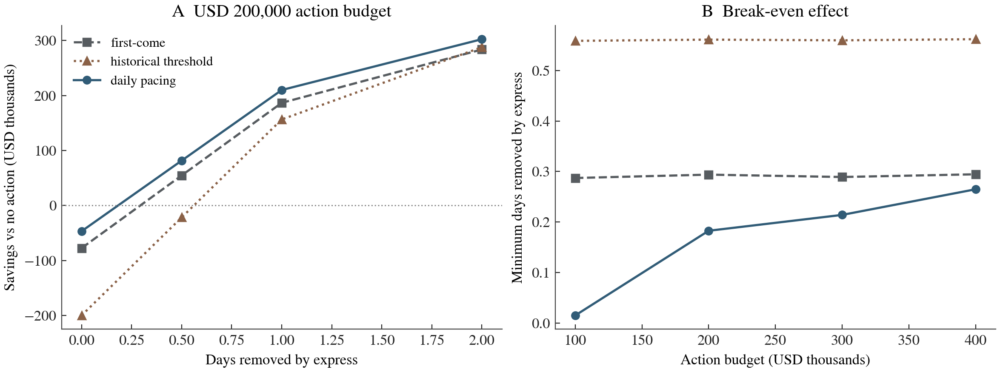

# 流式干预决策的效果敏感性

用 DataCo 的 9,863 笔测试订单比较先到先处理、历史阈值、每日预算释放。历史分布仅用训练切点前已有发运标签的订单估计。恢复既有逐单回放的假设后，锁定每笔订单的动作，再更换罚金和干预效果参数，检查同一份方案在效力偏差下的模拟成本。

## 全期分配的对照

用同一个运输方式经验分布计算各动作的预测成本。全期整数规划先看到全部测试订单的到达和预测，按相同预测成本向量聚合订单，求出每组中通知和加急的单数。两种动作的单数之和不得超过组内订单数，动作费合计不得超预算。分配组内相同预测成本的订单时使用到达顺序。求解器最优状态、动作费及目标值经回算校验。

| 干预预算（美元） | 全期整数规划预测成本（美元） | 全期贪心与最优值的差（美元） | 每日释放与最优值的差（美元） |
| ---: | ---: | ---: | ---: |
| 100,000 | 1,374,516 | 0 | 250,131 |
| 200,000 | 1,246,573 | 0 | 234,299 |
| 300,000 | 1,196,573 | 0 | 139,368 |
| 400,000 | 1,146,651 | 0 | 50,259 |

这四档预算下，全期贪心已达到分配模型的预测成本最优值。逐单方案和全期参照的差额合并了**信息时点、预算拨付规则和逐单决策方式**的影响。整数规划最优值适用于假设的预测分布、动作费用和全期预算，模拟结果按实际偏差和指定情景另行计费。

## 干预效果变弱后，是否还值得花钱

固定用 200 美元/天、通知后保留 60% 罚金、加急减少 2 天作为选择动作时的假设。测试时交叉设置 100 / 200 / 300 美元/天、通知后保留 60% / 80% / 100% 罚金、加急减少 0 / 0.5 / 1 / 2 天，得到每档预算 36 个情景。四档预算对每种策略使用相同的订单、成本和干预作用函数。通知和加急分别计算，超出原始正延迟的部分截为零。



以 **20 万美元预算、200 美元/天罚金、通知后保留 60% 罚金**为例：

| 冻结的逐单策略 | 加急仅减少 0.5 天时，相对不干预净节省（美元） | 相对不干预持平所需的最小加急效果（天） |
| --- | ---: | ---: |
| 先到先处理 | 54,500 | 0.294 |
| 历史阈值 | −21,800 | 0.561 |
| 每日释放 | 81,520 | 0.183 |

临界点用实际标签重算冻结方案的总模拟费用，等于 0 的净节省对应持平。这里的天数是为情景计算允许的连续参数。在示例中，历史阈值覆盖了更多优先订单，同时加急的临界效果更高。若希望按季度在这些候选间切换，应先用已结束的窗口选策略，留出下一窗口检验。

[36 个情景的逐项成本](../results/arrival_stress/scenarios.csv) · [预测成本最优值](../results/arrival_stress/expected_bounds.csv) · [持平阈值](../results/arrival_stress/break_even.csv) · [情景汇总](../results/arrival_stress/summary.csv)

```sh
python scripts/arrival_stress.py --data /path/to/DataCoSupplyChainDataset.csv
```
